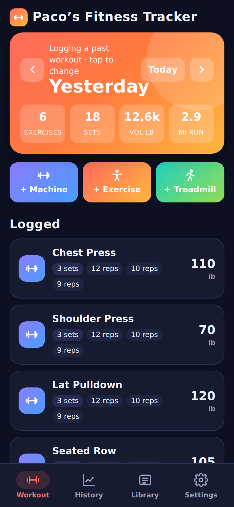
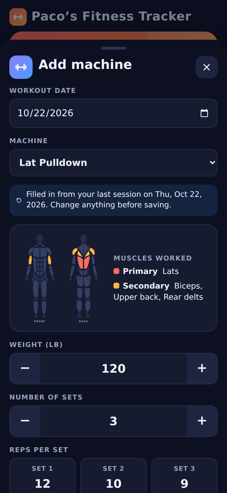
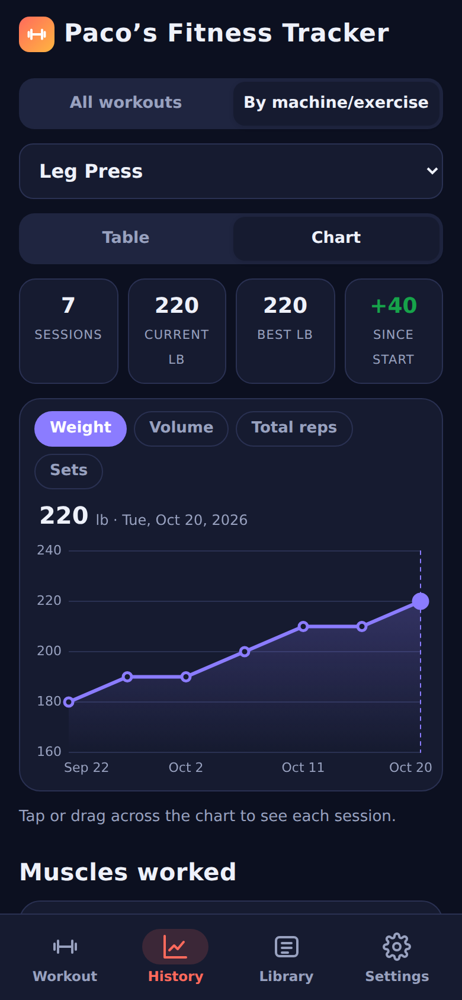
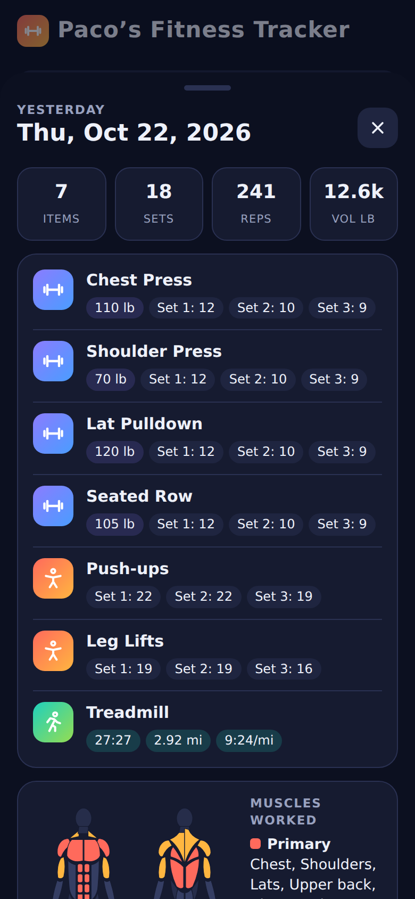
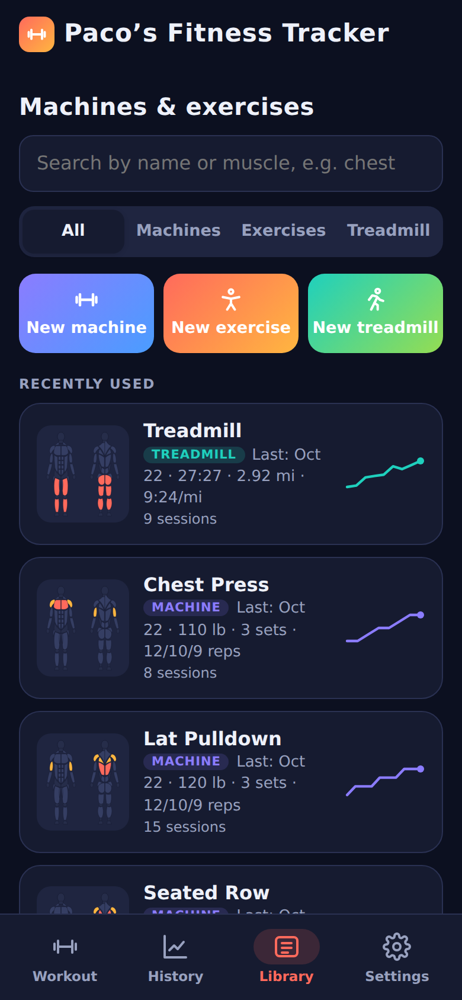

# Paco's Fitness Tracker

A colorful, private workout tracker for Android. Log every weight machine, bodyweight exercise and treadmill run, then see your progress as tables and charts. Everything stays on your phone: the app has no internet access and no accounts.

<p>
  
  
  
  
  
</p>

## Download

**[Get the latest version](https://github.com/PacoGeist/pacos-fitness-tracker/releases/latest)**: open the page on your Android phone and tap the `.apk` file under **Assets**.

Works on Android 8.0 or newer, including every current Samsung Galaxy phone.

## Features

- **Weight machines:** log the date, weight, number of sets and reps for each set. Pick a machine you've used before and your last weight, sets and reps fill in automatically.
- **Bodyweight exercises:** push-ups, crunches, leg lifts, pull-ups and more, with sets and reps. Holds like planks and wall sits count seconds.
- **Treadmill:** time and distance, with pace and speed worked out for you.
- **Built-in library:** 41 common gym machines and 48 bodyweight exercises, grouped by body area and searchable by name or muscle. Add your own at any time.
- **Muscle diagrams:** front and back body maps show the primary and secondary muscles for every machine, exercise and whole workout. You can change them.
- **History:** every workout as a list, table or chart, plus the full history of any single machine or exercise.
- **Repeat a workout:** copy any past workout to today, then adjust each machine.
- **Past workouts:** the date defaults to today but can be changed to log an earlier session.
- **Dark and light themes,** pounds or kilograms, miles or kilometers.
- **Backup and restore** to a file in your phone's Downloads folder.

## Installing

1. On your phone, open the [latest release](https://github.com/PacoGeist/pacos-fitness-tracker/releases/latest) and tap the `.apk` file to download it.
2. Tap the downloaded file. If the phone says installs from this source aren't allowed, tap **Settings**, turn on **Allow from this source**, and go back.
3. Tap **Install**. Google Play Protect may warn that the app is unknown because it isn't from the Play Store. Tap **More details > Install anyway**.

On Samsung phones with **Auto Blocker** turned on (Settings > Security and privacy > Auto Blocker), turn it off for the install and back on afterwards.

## Updating

In the app, go to **Settings > App updates > Check for updates**. This opens the download page in your browser. If the version there is newer than yours, download the `.apk` and install it over the app you have. Your workouts are kept.

## Privacy

- The app has **no internet permission**, so Android does not let it connect to anything. "Check for updates" only hands a link to your browser.
- No accounts, logins, ads, analytics or tracking. No location, camera, microphone or contacts access.
- Workouts are saved in the app's private storage on your phone. Uninstalling the app deletes them, so use **Settings > Back up > Export** now and then.

## Building it yourself

The app is a single web page (`app/src/main/assets/index.html`) shown inside a small native Android shell (`MainActivity.java`). It uses no third-party libraries.

Requirements: JDK 17 and the Android SDK (platform 34).

```
./gradlew assembleDebug
```

(On Windows without Git Bash, use `gradlew.bat assembleDebug`.) All files use LF line endings, enforced by `.gitattributes`; the only exception is `gradlew.bat`, which Windows needs in CRLF.

The test build appears in `app/build/outputs/apk/debug/`. To try the interface without a phone, open `app/src/main/assets/index.html` in a desktop browser; it loads sample workouts.

## Publishing a new version (maintainers)

1. Raise the version in **two places**, using the same number:
   - `gradle.properties`: add 1 to `APP_VERSION_CODE` and set `APP_VERSION_NAME` (for example `1.6`).
   - `app/src/main/assets/index.html`: set `const APP_VERSION = '1.6';`
2. Add a section for the new version to `CHANGELOG.md`.
3. Run `./publish.sh` (in Git Bash on Windows, or double-click it). It checks the version numbers, commits, pushes, and pushes the tag `v1.6`.
4. The **Build app** workflow builds a signed APK and creates the GitHub release with it, using the matching `CHANGELOG.md` section as the release notes.

Publishing a release from the GitHub website with a new `v…` tag works too.

Signed releases need four repository secrets (**Settings > Secrets and variables > Actions**): `SIGNING_KEYSTORE_BASE64`, `SIGNING_STORE_PASSWORD`, `SIGNING_KEY_ALIAS` and `SIGNING_KEY_PASSWORD`. The signing key itself is never stored in this repository. Every release must be signed with the same key, or phones will refuse to install it as an update.

The package id is `com.bekdevelopers.ironlog` (the app's original working name). It must not change, or updates would install as a separate app without the saved workouts.
